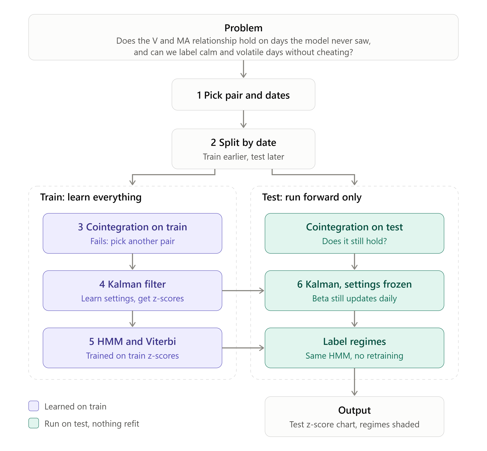
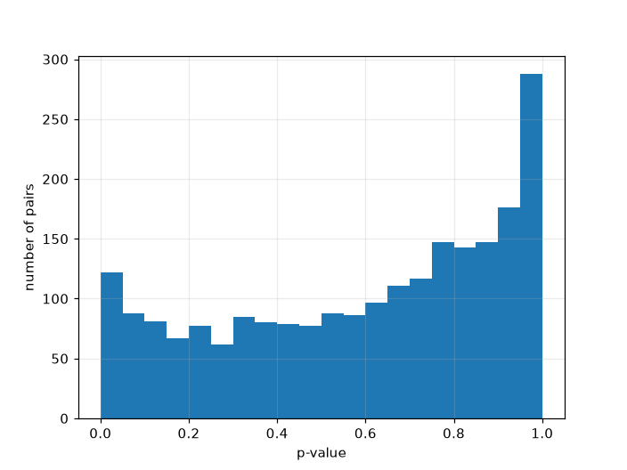

# Pairs Trading with a Kalman Filter and an HMM

This is my first quant project. I am learning quant finance, so I did the maths on paper first (Kalman filter, ADF, Engle-Granger, HMM, Baum-Welch and Viterbi, all worked by hand with small numbers) and then built the pipeline in Python with `pykalman` and `hmmlearn`.

It is a learning project. It is not a trading system, it does not prove anything makes money, and nothing here is financial advice. I wrote down the problems I found, because they taught me more than the results did.

**Status: on hold.** The screen found nothing that survives the correction, and the simulation shows why: it cannot see slow leashes. I built this to learn, and I have learned what I came for, so I am moving on to hypotheses I want to trade. The "What I want to do next" list below is what I would do if I came back.

## The idea

Think of two stocks tied together by a rubber band. Most days they move together. Sometimes the gap between them stretches, and if the band is real, it pulls back. A pairs trade bets on the pull back: sell the one that ran ahead, buy the other, and close when the gap is gone.

Two things can go wrong. The band might not be real (the stocks only looked linked), or the band might move (the hedge ratio drifts). The project is built around those two questions.



## How it works

1. **Find candidates.** `pairs.py` takes the Russell 1000 list from Wikipedia (1,021 tickers, share classes count separately) and downloads daily closes from Yahoo Finance for 2020-01-01 to 2024-01-01. The end date is fixed (`ISEND`), so the screen never sees data after it and the later data stays unseen for the test. Then two filters: only pairs in the same GICS sub-industry (3,625 of 520,710 pairs), then daily return correlation above 0.5 (2,218 pairs). 54 tickers have no data in this window and drop out.
2. **Check the band is real.** `cointegration.py` runs the Engle-Granger test (`statsmodels.coint`) on each of the 2,218 pairs, in both directions (y on x and x on y), and keeps the larger p-value. It needs at least 30 common dates. Then it applies the Benjamini-Hochberg correction across all 2,218 tests at 5%. Every pair's p-value is kept, not only the small ones, because the correction needs to know how many tests I ran. When I study one pair, I split by date and check cointegration on the train and test parts separately.
3. **Track the hedge ratio.** `kalman_filter.py` uses a Kalman filter with two hidden states, the hedge ratio (beta) and the intercept. Transition covariance is 1e-6 and observation covariance is 1.0. Today's spread uses yesterday's estimate (`.shift(1)`), so there is no peeking.
4. **Score the gap.** The spread is turned into a rolling 20 day z-score.
5. **Label calm and volatile days.** `regimes.py` fits a 2 state Gaussian HMM on the absolute spread. The spread is clipped at 3 standard deviations before fitting (see problem 1 below). I call the lower variance state "calm".
6. **Trade rules.** `strategy.py` enters when the z-score is beyond 2 or below -2 and the day is calm. It exits when the z-score crosses 0. One unit of Y against beta units of X, P&L in dollars, filled at the same day's close, no costs.

`main.py` runs the screen (steps 1 and 2). It writes every pair with its p-value and whether it passed the correction to `cointegrated_pairs.csv`, writes the survivors to `cointegrated_pairs_BH.csv`, and saves the p-value histogram as `pvalue_hist.png`. The strategy (steps 3 to 6) and the plots are below it, commented out. To run them on one pair, comment out the screen and uncomment those cells.

## What I found

**Fixed hedge ratio vs Kalman (KO and PEP, 2023-01-04 to 2026-10-28).** I fit a fixed hedge ratio on the first 252 trading days (2022) and compared it with the Kalman one. The biggest gap between Coca-Cola and its hedge was $42.49 per share with the fixed ratio and $5.94 with the Kalman filter. This shows gap size, not backtest profit. The fixed one is a deliberately simple baseline. Anyone betting the gap closes would have sat through a gap that stayed wide.

**The screen.** 2,218 pairs were tested. 122 pass p < 0.05 and 25 pass p < 0.01 when both directions must pass. After the Benjamini-Hochberg correction at 5%, **0 survive**.



The histogram shows all 2,218 p-values: 122 in the first bin (p below 0.05) and 288 in the last bin (near 1.0). There is a pile near 1.0 because I take the larger of two p-values, and that pushes values up. When I put pure noise through the same rule in the simulation below, about 2% pass at p < 0.05, so luck alone gives about 43 of 2,218. I see 122, so there is some signal, but none of it is strong enough to survive the correction.

The closest pair was EXP and VMC (p = 0.000078). To survive, the best pair among 2,218 needs a p-value below 0.05 / 2,218 = 0.0000225. It missed by about 3.5 times. I am not going to trade it, because picking the best pair after it failed the screen would be picking on the same data.

I did run EXP and VMC through the strategy code, only to see the code work on a longer series. The Kalman and HMM run trained on 2020-01 to about 2024-09, made 21 trades (11 wins, 10 losses) and ended at -$17.79 in dollars, with same-close fills and no costs. On the test part (about 2024-10 to 2026-10), the fixed-hedge gap wandered from about -40 to +85, with lag-1 autocorrelation 0.989 (half-life about 63 days) and cointegration p-values of 0.109 on train and 0.670 on test. The Kalman spread looks calm on the same days, because it re-centres itself every day. The later data gave this pair no support. This was my one look at the later data for this pair, so for EXP and VMC it is no longer unseen (see problem 10).

I ran the same rules on the S&P 500 alone first: 1,065 pairs tested, 0 survivors, and the best pair (LEN and NVR, p = 0.00055) missed by about 12 times. A bigger universe makes the bar stricter, and the best pair still got closer.

My first version of the screen used price correlation above 0.95 and no correction. It gave 660 pairs at p < 0.05 on the S&P 500. When I split the history at three dates (2022, 2023 and 2024), about 9 in 10 of the pairs that passed on the data before the split failed on the data after it, on average. That is why I rebuilt the screen.

**Can the screen find a real pair?** A result of zero only means something if the screen could have found a pair when one exists. So I tested it. `simulation.py` builds 50 pairs with a leash on purpose: one random walk, and a second series that is the first plus a gap that is pulled back each day. I hide them among 2,168 pairs of independent random walks, 2,218 in total, the same count as the real run. Then I run the same test (both directions, larger p-value, Benjamini-Hochberg at 5%) on all of them. Each series has 1,006 days, like the real data.

| How fast the gap is pulled back (phi) | Half-life of the gap | Planted pairs found | Noise pairs that passed |
|---|---|---|---|
| 0.80 | 3.1 days | 50 of 50 | 1 of 2,168 |
| 0.90 | 6.6 days | 50 of 50 | 1 of 2,168 |
| 0.95 | 13.5 days | 41 of 50 | 1 of 2,168 |

The one noise pair that passes is the same each time. One false pass among about 50 discoveries is what a 5% false discovery rate allows. So the screen finds a clear leash and almost never makes one up.

**Where the screen goes blind.** My planted leashes pull back in 3 to 14 days. Real pairs are slower. For the 12 best pairs in my own CSV, the half-life of the gap (from the lag-1 autocorrelation of the residual, in trading days) is 12 to 38 days. The half-life is how long the gap takes to shrink to half its size. The exact value depends on how I estimate it, so I read it as "weeks, not days". So I pushed the simulation to slower leashes, with the same 2,218 tests:

| phi | Half-life of the gap | Planted pairs found | Noise pairs that passed |
|---|---|---|---|
| 0.95 | 13.5 days | 43 of 50 | 1 |
| 0.96 | 17.0 days | 19 of 50 | 1 |
| 0.97 | 22.8 days | 0 of 50 | 0 |
| 0.98 | 34.3 days | 0 of 50 | 0 |
| 0.99 | 69.0 days | 0 of 50 | 0 |

The exact counts move by a few pairs with the random seed (another seed gave 35 of 50 and 16 of 50 for the first two rows), but the drop to zero between 0.96 and 0.97 does not. With 2,218 tests the bar is so strict that the screen cannot certify a pair whose gap takes about 20 trading days (roughly a month) or more to halve, and most of my best pairs sit right there. So 0 survivors means no pair with a fast, clean leash. It does not mean there is nothing there: 122 pairs pass p < 0.05 against about 40 expected from noise. I cannot tell which ones are real.

The share classes of one company are a weak check of this. GOOGL and GOOG rank 89th of 2,218 (p = 0.035), but the classes are not convertible into each other, so the price gap between them is free to wander. I do not use them as a power test.

What the simulation does not cover: a gap that wanders instead of a clean pull-back, and real stocks. The noise pairs are independent random walks, but real stocks in the same industry share moves, so real noise is not exactly the same. I have run only a few random seeds.

**Real band vs no band.**

| Pair | p-value, train | p-value, test | Lag-1 autocorrelation of the fixed-hedge residual |
|---|---|---|---|
| SPY / IVV | 0.008 | 0.007 | 0.34 |
| V / MA | 0.079 | 0.70 | 0.986 |
| V / AAPL | 0.41 | 0.93 | 0.992 |

A low autocorrelation means the gap comes back fast, close to 1 means it drifts. This was the cleanest separator I found. The Kalman spread on its own hides the difference: for V and MA the half-life looks like 1.2 days with the Kalman spread and 49 days with a fixed hedge. So check cointegration on the fixed hedge before trusting the Kalman spread.

SPY and IVV track the same index, so they work as a demo of the algorithm and not a way to make money: the spread is a few cents, and the three trades made 1 to 3 basis points each.

I checked the numbers in this section with separate replay scripts that are not in this repo yet.

## Problems I found (and what I did)

1. **The HMM collapsed onto one day.** On SPY and IVV, one day (2025-04-09) sat 21 standard deviations out. The HMM spent a whole state on it and the calm filter did nothing. Clipping the spread at 3 standard deviations before fitting fixed it (variances 0.0061 and 0.067, then 3 trades, all wins). The clip bound uses a standard deviation that still includes the outlier, so it is a patch, not a clean fix.
2. **Fills are at the same close that made the signal.** That flatters results. Next-day fills are the fair test and I have not built that yet.
3. **Too few trades to say anything.** With 2 to 11 trades per pair, P&L is noise. V/AAPL goes from -121 bps to +51 bps depending only on which state I trade.
4. **No costs.** No commissions, no borrow cost for the short leg, no slippage.
5. **Old code in `main.py` (fixed).** The commented strategy cells called `split_data` with an older set of arguments. They now download with `download_data` first and then call `split_data(x, y, 0.7)`. The split used the length of the first stock for both, so two stocks with different numbers of days would not line up. Fixed: `download_data` now keeps only the dates both stocks share (`pd.concat(...).dropna()`), so the split lines up.
6. **Cointegration can be real for a while and then stop.** The screen and the train/test check only look at one window. A pair can be cointegrated for two years, then break (a merger, a business change, one company moving to a different stage) and the spread just keeps running away. The Kalman hedge ratio hides this, because it keeps re-fitting and the spread looks fine (problem seen on V/MA). Ideas I have to catch it, none built yet:
   - Re-run the cointegration test on a rolling window (for example the last 252 days) and stop trading the pair when the p-value goes above a limit.
   - Track the half-life of the spread. If it gets much longer than it was in training, the band is loosening.
   - Watch the Kalman hedge ratio and its error. A hedge ratio that keeps drifting in one direction is a warning.
   - A hard stop: close the trade if the z-score goes past 4, and close it if it has been open longer than about 3 times the half-life.
   - Size small until a pair has kept passing the test out of sample, and cap the loss on any one pair.
   - Run a structural break test (for example CUSUM) on the fixed-hedge residual.

   The goal is to find out the band is gone after a small loss, not after the spread has run for months.
7. **The hedge ratio is locked on the entry day.** `strategy.py` keeps the beta from the day the trade opened (`entry_beta`) until it closes, while the Kalman filter keeps updating it. On a trade that stays open for weeks, my shares of X drift away from the current hedge. I locked it on purpose, because rebalancing every day costs money. I have not measured which way is better, so I cannot say the choice is right.
8. **The filters decide which pairs get tested at all (changed).** I replaced the 0.95 price correlation filter. The screen now keeps pairs in the same sub-industry with daily return correlation above 0.5, and corrects for the number of tests with Benjamini-Hochberg. Price correlation is high for almost any two stocks that trend up, which is why 0.95 on prices told me little. Return correlation is the stricter test. I chose the 0.5 before running and did not tune it. I have not tested pairs from different sub-industries, so I do not know if a good pair lives there.
9. **The stock list has survivorship bias.** I take today's Russell 1000 list and look back to 2020. Companies that were removed or delisted in between are not in it, and stocks that did well tend to stay, so the list looks better than the real past. 54 tickers had no data in the window (many came to the market after 2020) and drop out. Share classes of one company (LEN and LEN-B, GOOG and GOOGL) are separate tickers, so one company can appear twice in the tests, which makes the number of truly separate tests a bit smaller than 2,218.
10. **The strategy test must use data the screen never saw.** The screen uses 2020-01-01 to 2023-12-31. If I run the strategy on one pair inside that range, the pair was already picked on those days, so the profit means nothing. The commented cells in `main.py` use a short 2020 range only to check that the code runs. A fair test picks the pair on data up to `ISEND` and judges it once on data after it. I have used that later data once, on EXP and VMC (see "The screen"), so for that pair it is spent. For every other pair it is still untouched.
11. **The screen goes blind at a half-life of about 20 trading days.** With 2,218 tests it finds planted pairs that pull back within about 17 days and none beyond about 23 days (see "Where the screen goes blind"), and my best real pairs have half-lives of 12 to 38 days. So 0 survivors does not prove there is nothing to find. It also means any change to the rules I make now, after seeing this result, needs data the screen has not seen.

## What I want to do next

- Fill after the signal, at the open or the close of the next day, and see how much of the result is left.
- Add costs.
- Compare the locked hedge ratio with rebalancing to the current Kalman beta, with costs on, and see which one holds up.
- Check whether cointegration comes in windows. Use rolling 1 year windows, stepped monthly, on data before 2024 only. For each pair, see how often a pass is followed by another pass in the next window, and compare that with the pass rate over all windows. Passing by luck happens in about 5% of windows, so finding windows proves nothing, and the pass-again rate is what counts. Only if it is clearly higher, work out what predicts the end of a window (the half-life, the HMM state), and then take one look at the data after 2024-01-01.
- Make the simulation harder: a gap that wanders instead of a clean pull-back, noisier gaps, and many random seeds so the counts have error bars.
- Run the screen on pairs from different sub-industries with the rules decided before I run it. More tests means a stricter bar, so I do not expect many survivors.
- Build the checks from problem 6: a rolling cointegration test, a half-life check and hard stops, then see how much they would have saved on a pair that broke.
- Write the problem log up properly, with the replay scripts in the repo.

## Run it

Python with `yfinance`, `pandas`, `numpy`, `statsmodels`, `pykalman`, `hmmlearn` and `matplotlib`.

```
python main.py
```

This runs the screen. It downloads about 1,000 tickers, tests the pairs that pass the filters, and writes `cointegrated_pairs.csv` (every pair: Stock 1, Stock 2, P value, BH pass), `cointegrated_pairs_BH.csv` (survivors only) and `pvalue_hist.png`. It takes a few minutes. Yahoo data gets revised, so a new run will not match my numbers exactly.

```
python simulation.py
```

This runs the planted pair test. It needs `numpy` and `statsmodels` only and takes a few minutes.

## Files

| File | What it does |
|---|---|
| `pairs.py` | Russell 1000 list, download to `ISEND`, sub-industry and return correlation filters |
| `cointegration.py` | Engle-Granger both directions, Benjamini-Hochberg |
| `simulation.py` | Plants cointegrated pairs among noise pairs and counts how many the screen finds |
| `kalman_filter.py` | Kalman hedge ratio, spread, rolling z-score |
| `regimes.py` | 2 state HMM on the spread |
| `strategy.py` | Entry and exit rules and P&L |
| `plots.py` | Charts |
| `config.py` | Data download and train/test split |
| `main.py` | Runs the screen. The strategy and plots are below it, commented out |
| `cointegrated_pairs.csv` | Every pair tested with its p-value and whether it passed the correction |
| `cointegrated_pairs_BH.csv` | Pairs that survived the correction (empty so far) |
| `Images/pvalue_hist.png` | Histogram of all p-values |
| `Images/pairs_project_process_with_problem.png` | The process diagram at the top of this README |

## Disclaimer

This is research and study material, not financial advice. Past data says nothing certain about the future. Do not trade real money on it.
